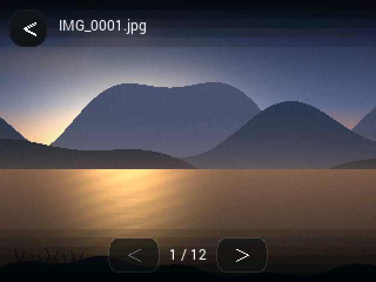
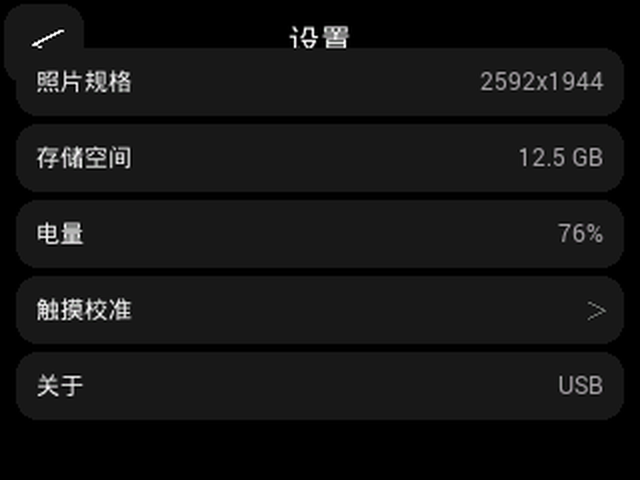
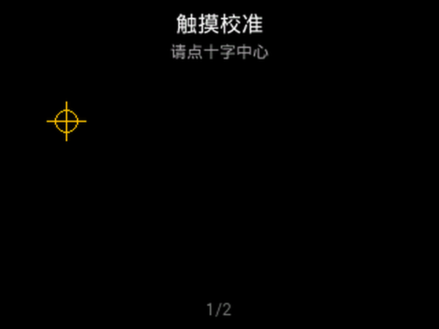

# ZeroSnap

**English** · [中文](README.zh-CN.md)

[](https://github.com/hellohub1212/zerosnap/actions/workflows/build.yml)
[](LICENSE)
[](https://www.raspberrypi.com/products/raspberry-pi-zero/)
[](native/src/ui.c)
[](app/)
[](docs/architecture.md)
[](docs/tuning.md)

A pocket camera that boots straight into the viewfinder on a **Raspberry Pi Zero**
with a **2.4" SPI LCD** — no desktop, no X11, no SDL, no pygame. The UI is C11
drawing directly into `/dev/fb1`; a small Python daemon owns the camera and talks
to it through shared memory.


| Gallery | Photo view |
|:---:|:---:|
|  |  |

| Settings | Touch calibration |
|:---:|:---:|
|  |  |

*Rendered from the real 320×240 UI. The sample photos are synthetic landscapes,
not third-party images.*

## Contents

- [Why this exists](#why-this-exists)
- [Features](#features)
- [Hardware](#hardware)
- [Install](#install)
- [Touch calibration](#touch-calibration)
- [How it works](#how-it-works)
- [Performance](#performance)
- [Project layout](#project-layout)
- [Testing](#testing)
- [Limitations](#limitations)
- [Contributing](#contributing)
- [License](#license)
- [Credits](#credits)

## Why this exists

The first version of this camera was Python + pygame on X11. It worked, but the
screen ran at **0.9 fps**:

```
preview: 25.5 fps, capture=39 ms, convert=0.2 ms   ← the camera was fine
ui: 0.9 fps, update+draw+flip=1004 ms/frame        ← the display path was not
```

A 320×240 frame takes a few milliseconds to draw on an ARMv6. The second was
spent inside a blocking display call: X11 → legacy framebuffer → `fbcp` →
`vc_dispmanx_snapshot()` → SPI panel. Removing that chain — and writing 16-bit
pixels straight into the panel's framebuffer — took the same hardware to
**26.5 fps**, which is the SPI link's ceiling (153,600 bytes per frame at
31.25 MHz = 39 ms).

So this is not "a Python app rewritten in C for speed". It is a camera that
does not use a display server at all.

## Features

- **Boots in ~8 s** to a two-tap calibration screen, then the viewfinder. No
  login, no desktop.
- **26 fps** on a 320×240 panel over SPI (panel-limited, not CPU-limited).
- **5 MP stills** (2592×1944) from an OV5647.
- **On-device gallery** with instant thumbnails: the daemon pre-renders a
  320×240 RGB565 preview next to each photo, so the UI never decodes a JPEG.
- **Photos land on the FAT32 boot partition** (`/boot/firmware/Camera`), so you
  can pull them off on Windows or macOS with no extra tools.
- **Touch calibration on every boot** — the panel is rotated 270° while the
  ADS7846 reports native axes; two taps solve the transform before you use the
  camera. The saved config is only the fallback if the wizard times out.
- **Crash-safe**: a supervisor restarts the camera daemon, the UI reconnects
  every second, and after three fast failures the console stays on the screen
  with the log instead of a black panel.
- **No network, no cloud, no telemetry.**

## Hardware

| Part | Notes |
|---|---|
| Raspberry Pi Zero v1.3 | ARMv6, 512 MB. Zero W is the same; Zero 2 W is faster. |
| 2.4" ILI9341 SPI LCD, 320×240 | The common "tft9341" module with an ADS7846 resistive touch panel. |
| OV5647 camera | Any libcamera-supported sensor should work. |
| microSD, 8 GB+ | Photos live on the boot partition. |

The installer ships the `tft9341` device-tree overlay (taken from LCD-show) and
adds `speed=32000000,fps=60,txbuflen=65536` to `config.txt`.

## Install

On a fresh **Raspberry Pi OS Bookworm (32-bit, Lite)**:

```bash
sudo apt update
sudo apt install -y build-essential python3-picamera2 python3-numpy python3-pil

git clone https://github.com/hellohub1212/zerosnap.git
cd zerosnap
sudo bash install/install.sh
sudo reboot
```

The installer:

1. builds `zerosnap-ui` and installs everything under `/opt/zerosnap`;
2. installs `zerosnap-ui.service` on tty1 and disables LightDM / fbcp;
3. adds the panel overlay and tuning to `config.txt`;
4. pre-compiles `libyuv420.so` so boot never runs a compiler;
5. creates `/boot/firmware/Camera` and its `.preview` cache;
6. points Xorg at `/dev/fb1` and sets LightDM's autologin session to LXDE.

Back to the desktop: **Settings → 退出到桌面**. The camera stops cleanly and
LightDM starts LXDE; the **ZeroSnap 相机** icon on the desktop switches back.
The command-line equivalents are:

```bash
sudo systemctl start zerosnap-desktop   # camera -> desktop
sudo systemctl start zerosnap-ui        # desktop -> camera
```

### Cross-compiling from a PC

With the SD card mounted and `clang` + `lld` installed, no emulator is needed:

```bash
sudo bash native/build-arm.sh --root /mnt/card
sudo bash install/install.sh --root /mnt/card --boot /mnt/cardboot
```

## Touch calibration

The display is rotated 270° by the panel overlay, but the ADS7846 reports the
panel's native axes. Without a transform every tap lands 90° away — which looks
exactly like "the buttons don't work".

On every boot the UI shows a two-tap wizard before the viewfinder settles. Tap
the two crosses; the transform is solved and stored in
`/boot/firmware/zerosnap-touch.conf` (FAT32, editable from Windows):

```
swap=1
invert_x=0
invert_y=1
```

If no touch event arrives for 45 s the wizard gives up and the saved transform
is used, so the device never gets stuck on the calibration screen. Re-run the
wizard any time from **Settings → Touch calibration**.

## How it works

```
┌──────────────────────────────┐          ┌──────────────────────────────┐
│ zerosnap-ui           (C11)  │          │ app.daemon          (Python) │
│                              │          │                              │
│  /dev/fb1   direct mmap      │  shared  │  Picamera2 / libcamera       │
│  /dev/input evdev touch      │◀────────▶│  still capture → JPEG        │
│  hit testing, views, icons   │  memory  │  320×240 RGB565 previews     │
│  pre-rendered text atlas     │          │  .565 gallery thumbnails     │
└──────────────────────────────┘          └──────────────────────────────┘
```

- **One shared-memory segment** (`/dev/shm/zerosnap-shm`) carries a
  double-buffered 320×240 RGB565 frame, a state snapshot and a command counter.
  No JSON, no parsing, no allocation on the hot path.
- **Text is pre-rendered at build time.** `tools/gen_font.py` rasterises every
  UI string (plus an ASCII strip for numbers and file names) into 8-bit alpha
  masks. The runtime needs no freetype and no font file.
- **Previews are pre-converted.** The daemon writes `Camera/.preview/*.565`
  next to each photo; the gallery blits them directly.
- **Video was removed on purpose.** The Pi Zero cannot sustain a usable H.264
  frame rate here; a camera that records 9 frames in 20 seconds is worse than a
  camera that only takes photos.

More detail: [`docs/architecture.md`](docs/architecture.md).

## Performance

Measured on a Pi Zero v1.3, 320×240, SPI requested 32 MHz (31.25 MHz effective):

| Metric | Value |
|---|---|
| UI frame rate | **26.5 fps** |
| Draw | 3.4 ms |
| Present (`memcpy` into `/dev/fb1`) | 18 ms |
| Camera preview | 25 fps (sensor-mode limit) |
| Full-frame SPI transfer | 39 ms (theoretical ceiling 25.4 fps) |

Startup was tuned too: firmware → kernel dropped from 15–29 s (it varied with
FAT repair) to ~10 s, and the viewfinder service now starts at ~12 s instead of
27–41 s. The Python import overlaps the media-mount wait, PyAV is loaded lazily,
and LightDM no longer waits 90 s for DRM devices that the SPI panel never
provides. Details and measured markers: [`docs/tuning.md`](docs/tuning.md).

The panel is the bottleneck. `zerosnap-bench` measures it directly:

```bash
sudo systemctl stop zerosnap-ui
/opt/zerosnap/bin/zerosnap-bench --seconds 6
sudo systemctl start zerosnap-ui
```

Tuning knobs and their trade-offs: [`docs/tuning.md`](docs/tuning.md).

## Project layout

```
app/                 Python camera daemon
  daemon.py            shared-memory publisher + command handling
  camera_shm.py        the Python half of the shm contract
  backend/             Picamera2 service (and a mock for laptops)
  media/storage.py     sequence-numbered file names
native/              C11 UI, zero third-party dependencies
  src/fb.c             /dev/fb1 open/mmap/present
  src/gfx.c            RGB565 primitives
  src/text.c           pre-rendered glyph blitter
  src/input.c          evdev (multitouch B, single touch, pressure)
  src/touchcal.c       two-point axis calibration
  src/ipc.c            shared memory
  src/media.c          media scan + .565 cache
  src/ui.c             views, hit testing, drawing
  src/main.c           the loop
  src/text_data.c      generated glyph atlas
  tools/gen_font.py    build-time text atlas generator
  tools/make_screenshots.py  README screenshots from the real UI
install/             installer, systemd unit, launcher, panel overlay
docs/                architecture, tuning, screenshots
```

## Testing

Everything runs on the build host — no Pi required:

```bash
make test
```

Covers glyph rendering and clipping, evdev parsing (multitouch B, single touch,
pressure-only, transforms), the shared-memory frame/state/command protocol in
both languages, media scanning and cache invalidation, the calibration solver
(all eight transforms), and an end-to-end test that pushes a frame through
shared memory and asserts the pixels that reached the framebuffer.

`make screenshots` re-renders the images above from the actual UI
(`native/tools/make_screenshots.py`, needs Pillow). The scenes are generated, so
the repository carries no third-party photographs.

## Limitations

- **No video.** Removed by design; see above.
- **5 MP maximum** (2592×1944). The OV5647 is a 5 MP sensor — 4K is impossible.
- The preview freezes briefly while a still is captured, so the encoder and the
  UI never fight over camera requests.
- Tested on Raspberry Pi OS Bookworm 32-bit only.

## Contributing

Issues and pull requests are welcome. Please run `make test` before opening a
PR; see [`CONTRIBUTING.md`](CONTRIBUTING.md) for details.

## License

MIT — see [`LICENSE`](LICENSE). Third-party components and their licences are
listed in [`NOTICE.md`](NOTICE.md).

## Credits

- [Picamera2](https://github.com/raspberrypi/picamera2) and libcamera;
- [LCD-show](https://github.com/goodtft/LCD-show) for the tft9341 overlay;
- The early pygame prototype — it is gone, but its measurements are what pointed
  at the real problem.
