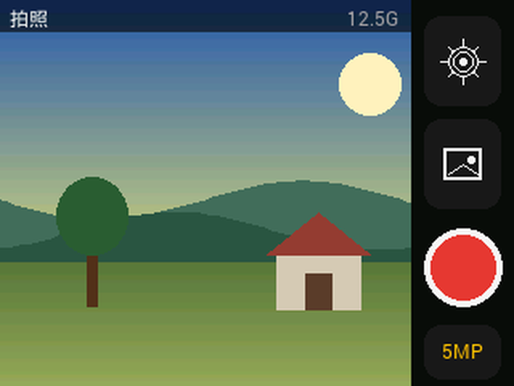
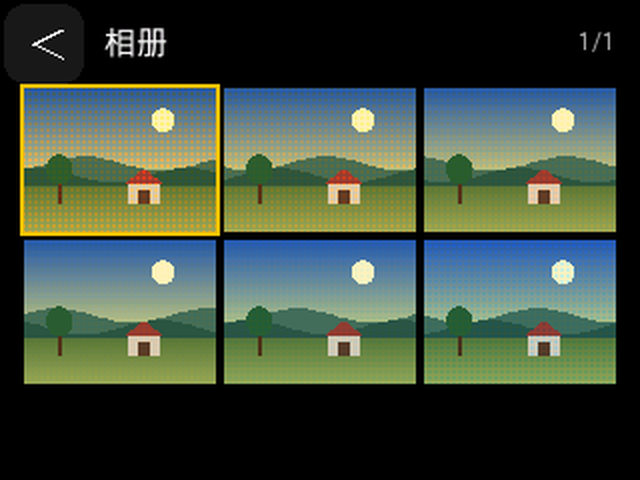

# ZeroSnap

**English** · [中文](#中文)

A pocket camera that boots straight into the viewfinder on a **Raspberry Pi Zero**
with a **2.4" SPI LCD** — no desktop, no X11, no SDL, no pygame. The UI is C++
drawing directly into `/dev/fb1`; a small Python daemon owns the camera and talks
to it through shared memory.



| Gallery | Settings | Touch calibration |
|:---:|:---:|:---:|
|  |  |  |

---

## Why this exists

The first version of this camera was Python + pygame on X11. It worked, but the
screen ran at **0.9 fps**:

```
preview: 25.5 fps, capture=39 ms, convert=0.2 ms   ← the camera was fine
ui: 0.9 fps, update+draw+flip=1004 ms/frame        ← the display path was not
```

A 320×240 frame takes a few milliseconds to draw on an ARMv6. The second was
spent inside a blocking display call: X11 → legacy framebuffer → `fbcp` →
`vc_dispmanx_snapshot()` → SPI panel. Removing that chain — and writing 16-bit
pixels straight into the panel's framebuffer — took the same hardware to
**26.5 fps**, which is the SPI link's ceiling (153,600 bytes per frame at
31.25 MHz = 39 ms).

So this is not "a Python app rewritten in C++ for speed". It is a camera that
does not use a display server at all.

## Features

- **Boots to the viewfinder** in ~8 s. No login, no desktop.
- **26 fps** on a 320×240 panel over SPI (panel-limited, not CPU-limited).
- **5 MP stills** (2592×1944) from an OV5647.
- **On-device gallery** with instant thumbnails: the daemon pre-renders a
  320×240 RGB565 preview next to each photo, so the UI never decodes a JPEG.
- **Photos land on the FAT32 boot partition** (`/boot/firmware/Camera`), so you
  can pull them off on Windows or macOS with no extra tools.
- **Touch calibration wizard** — the panel is rotated 270° while the ADS7846
  reports native axes; two taps solve the transform.
- **Crash-safe**: a supervisor restarts the camera daemon, the UI reconnects
  every second, and after three fast failures the console stays on the screen
  with the log instead of a black panel.
- **No network, no cloud, no telemetry.**

## Hardware

| Part | Notes |
|---|---|
| Raspberry Pi Zero v1.3 | ARMv6, 512 MB. Zero W is the same; Zero 2 W is faster. |
| 2.4" ILI9341 SPI LCD, 320×240 | The common "tft9341" module with an ADS7846 resistive touch panel. |
| OV5647 camera | Any libcamera-supported sensor should work. |
| microSD, 8 GB+ | Photos live on the boot partition. |

The installer ships the `tft9341` device-tree overlay (taken from LCD-show) and
adds `speed=32000000,fps=60,txbuflen=65536` to `config.txt`.

## Install

On a fresh **Raspberry Pi OS Bookworm (32-bit, Lite)**:

```bash
sudo apt update
sudo apt install -y build-essential python3-picamera2 python3-numpy python3-pil

git clone https://github.com/<you>/zerosnap.git
cd zerosnap
sudo bash install/install.sh
sudo reboot
```

The installer:

1. builds `zerosnap-ui` and installs everything under `/opt/zerosnap`;
2. installs `zerosnap-ui.service` on tty1 and disables LightDM / fbcp;
3. adds the panel overlay and tuning to `config.txt`;
4. pre-compiles `libyuv420.so` so boot never runs a compiler;
5. creates `/boot/firmware/Camera` and its `.preview` cache.

Back to the desktop at any time:

```bash
sudo systemctl start lightdm      # zerosnap-ui is stopped by Conflicts=
```

### Cross-compiling from a PC

With the SD card mounted and `clang` + `lld` installed, no emulator is needed:

```bash
sudo bash native/build-arm.sh --root /mnt/card
sudo bash install/install.sh --root /mnt/card --boot /mnt/cardboot
```

## Touch calibration

The display is rotated 270° by the panel overlay, but the ADS7846 reports the
panel's native axes. Without a transform every tap lands 90° away — which looks
exactly like "the buttons don't work".

On first boot the UI shows a two-tap wizard. Tap the two crosses; the transform
is solved and stored in `/boot/firmware/zerosnap-touch.conf` (FAT32, editable
from Windows):

```
swap=1
invert_x=0
invert_y=1
```

Re-run it any time from **Settings → 触摸校准**. If no touch event arrives for
45 s the wizard gives up, so the device never gets stuck.

## How it works

```
┌──────────────────────────────┐          ┌──────────────────────────────┐
│ zerosnap-ui           (C++)  │          │ app.daemon          (Python) │
│                              │          │                              │
│  /dev/fb1   direct mmap      │  shared  │  Picamera2 / libcamera       │
│  /dev/input evdev touch      │◀────────▶│  still capture → JPEG        │
│  hit testing, views, icons   │  memory  │  320×240 RGB565 previews     │
│  pre-rendered text atlas     │          │  .565 gallery thumbnails     │
└──────────────────────────────┘          └──────────────────────────────┘
```

- **One shared-memory segment** (`/dev/shm/zerosnap-shm`) carries a
  double-buffered 320×240 RGB565 frame, a state snapshot and a command counter.
  No JSON, no parsing, no allocation on the hot path.
- **Text is pre-rendered at build time.** `tools/gen_font.py` rasterises every
  UI string (plus an ASCII strip for numbers and file names) into 8-bit alpha
  masks. The runtime needs no freetype and no font file.
- **Previews are pre-converted.** The daemon writes `Camera/.preview/*.565`
  next to each photo; the gallery blits them directly.
- **Video was removed on purpose.** The Pi Zero cannot sustain a usable H.264
  frame rate here; a camera that records 9 frames in 20 seconds is worse than a
  camera that only takes photos.

More detail: [`docs/architecture.md`](docs/architecture.md).

## Performance

Measured on a Pi Zero v1.3, 320×240, SPI requested 32 MHz (31.25 MHz effective):

| Metric | Value |
|---|---|
| UI frame rate | **26.5 fps** |
| Draw | 3.4 ms |
| Present (`memcpy` into `/dev/fb1`) | 18 ms |
| Camera preview | 25 fps (sensor-mode limit) |
| Full-frame SPI transfer | 39 ms (theoretical ceiling 25.4 fps) |

The panel is the bottleneck. `zerosnap-bench` measures it directly:

```bash
sudo systemctl stop zerosnap-ui
/opt/zerosnap/bin/zerosnap-bench --seconds 6
sudo systemctl start zerosnap-ui
```

Tuning knobs and their trade-offs: [`docs/tuning.md`](docs/tuning.md).

## Project layout

```
app/                 Python camera daemon
  daemon.py            shared-memory publisher + command handling
  camera_shm.py        the Python half of the shm contract
  backend/             Picamera2 service (and a mock for laptops)
  media/storage.py     sequence-numbered file names
native/              C++ UI, zero third-party dependencies
  src/fb.c             /dev/fb1 open/mmap/present
  src/gfx.c            RGB565 primitives
  src/text.c           pre-rendered glyph blitter
  src/input.c          evdev (multitouch B, single touch, pressure)
  src/touchcal.c       two-point axis calibration
  src/ipc.c            shared memory
  src/media.c          media scan + .565 cache
  src/ui.c             views, hit testing, drawing
  src/main.c           the loop
  src/text_data.c      generated glyph atlas
install/             installer, systemd unit, launcher, panel overlay
docs/                architecture, tuning, screenshots
```

## Tests

Everything runs on the build host — no Pi required:

```bash
make test
```

Covers glyph rendering and clipping, evdev parsing (multitouch B, single touch,
pressure-only, transforms), the shared-memory frame/state/command protocol in
both languages, media scanning and cache invalidation, the calibration solver
(all eight transforms), and an end-to-end test that pushes a frame through
shared memory and asserts the pixels that reached the framebuffer.

## Limitations

- **No video.** Removed by design; see above.
- **5 MP maximum** (2592×1944). The OV5647 is a 5 MP sensor — 4K is impossible.
- The preview freezes briefly while a still is captured, so the encoder and the
  UI never fight over camera requests.
- Tested on Raspberry Pi OS Bookworm 32-bit only.

## License

MIT — see [`LICENSE`](LICENSE). Third-party components and their licences are
listed in [`NOTICE.md`](NOTICE.md).

---

# 中文

[English](#zerosnap) · **中文**

一台**开机直接进取景框**的随身相机：树莓派 Zero + 2.4 寸 SPI 屏，
**不启动桌面、不用 X11、不用 SDL、不用 pygame**。界面是 C++ 直接写
`/dev/fb1`，相机由一个小 Python 守护进程负责，两者通过共享内存通信。


| 相册 | 设置 | 触摸校准 |
|:---:|:---:|:---:|
|  |  |  |

## 为什么会有这个项目

第一版是 Python + pygame + X11。功能都能跑，但屏幕只有 **0.9 fps**：

```
preview: 25.5 fps, capture=39 ms, convert=0.2 ms   ← 相机完全正常
ui: 0.9 fps, update+draw+flip=1004 ms/frame        ← 显示链路不正常
```

320×240 的一帧在 ARMv6 上只要几毫秒。那一秒全花在阻塞的显示调用里：
X11 → 传统 framebuffer → `fbcp` → `vc_dispmanx_snapshot()` → SPI 屏。
把整条链路删掉、直接往面板的 framebuffer 写 16 位像素之后，同一块板子跑到了
**26.5 fps** —— 这已经是 SPI 的上限（153,600 字节/帧，31.25 MHz 下 39 ms）。

所以这不是"把 Python 用 C++ 重写一遍来提速"，而是一台**根本不使用显示服务器**
的相机。

## 功能

- **开机约 8 秒进取景框**，没有登录、没有桌面；
- **26 fps**（320×240 SPI 屏，瓶颈在面板不在 CPU）；
- **500 万像素拍照**（2592×1944，OV5647）；
- **机内相册**：守护进程给每张照片预生成 320×240 RGB565 预览，
  界面不需要解码 JPEG，翻页是即时的；
- **照片存在 FAT32 启动分区**（`/boot/firmware/Camera`），
  插到 Windows / macOS 上直接就能拷走；
- **触摸校准向导**：屏幕被旋转了 270°，而 ADS7846 上报的是面板原始轴，
  点两下自动算出轴变换；
- **不怕崩**：守护进程有监督循环，界面每秒重连共享内存；连续失败 3 次后
  把 console 留在屏幕上并写日志，而不是黑屏；
- **不联网、不上云、没有遥测。**

## 硬件

| 部件 | 说明 |
|---|---|
| 树莓派 Zero v1.3 | ARMv6，512 MB。Zero W 同理，Zero 2 W 更快。 |
| 2.4 寸 ILI9341 SPI 屏，320×240 | 常见的 "tft9341" 模块，带 ADS7846 电阻触摸。 |
| OV5647 摄像头 | 其他 libcamera 支持的传感器应该也能用。 |
| microSD，8 GB 以上 | 照片放在启动分区。 |

安装脚本自带 `tft9341` 设备树 overlay（来自 LCD-show），并向 `config.txt`
写入 `speed=32000000,fps=60,txbuflen=65536`。

## 安装

在全新的 **Raspberry Pi OS Bookworm（32 位 Lite）** 上：

```bash
sudo apt update
sudo apt install -y build-essential python3-picamera2 python3-numpy python3-pil

git clone https://github.com/<you>/zerosnap.git
cd zerosnap
sudo bash install/install.sh
sudo reboot
```

安装脚本会：

1. 编译 `zerosnap-ui`，把整套东西装到 `/opt/zerosnap`；
2. 安装 `zerosnap-ui.service` 并占用 tty1，停用 LightDM / fbcp；
3. 写入屏幕 overlay 和刷新参数；
4. 预编译 `libyuv420.so`，保证开机不需要调用编译器；
5. 创建 `/boot/firmware/Camera` 和 `.preview` 缓存目录。

随时可以回到桌面：

```bash
sudo systemctl start lightdm      # 会通过 Conflicts= 停掉 zerosnap-ui
```

### 在电脑上交叉编译

把 SD 卡挂到电脑，装了 `clang` + `lld` 就不需要任何模拟器：

```bash
sudo bash native/build-arm.sh --root /mnt/card
sudo bash install/install.sh --root /mnt/card --boot /mnt/cardboot
```

## 触摸校准

屏幕在 overlay 里被旋转了 270°，但 ADS7846 上报的是面板原始坐标。
如果不做轴变换，所有点击都会偏 90° —— 表现就是"按钮按了没反应"。

首次开机会出现两点校准：依次点两个十字，程序从 8 种轴变换里选出正确的
那个，结果写到 `/boot/firmware/zerosnap-touch.conf`（FAT32，Windows 可直接改）：

```
swap=1
invert_x=0
invert_y=1
```

之后可以在 **设置 → 触摸校准** 重新来一次。如果 45 秒内没有任何触摸事件，
向导会自动退出，不会把设备卡在校准页。

## 工作原理

```
┌──────────────────────────────┐          ┌──────────────────────────────┐
│ zerosnap-ui           (C++)  │          │ app.daemon          (Python) │
│                              │          │                              │
│  /dev/fb1   直接 mmap        │   共享   │  Picamera2 / libcamera       │
│  /dev/input evdev 触摸       │◀────────▶│  拍照 → JPEG                 │
│  命中测试、视图、图标        │   内存   │  320×240 RGB565 预览         │
│  预渲染文字图集              │          │  .565 相册缩略图             │
└──────────────────────────────┘          └──────────────────────────────┘
```

- **一个共享内存段**（`/dev/shm/zerosnap-shm`）承载双缓冲的 320×240 RGB565
  帧、状态快照和命令序号。没有 JSON、没有解析、热路径上没有内存分配。
- **文字在构建期就渲染好了。** `tools/gen_font.py` 把每条界面文案（外加一套
  ASCII 字模，供文件名、数字使用）栅格化成 8 位 alpha 位图。运行时不需要
  freetype，也不需要字体文件。
- **预览是预转换的。** 守护进程给每张照片生成 `Camera/.preview/*.565`，
  相册直接 blit。
- **视频是有意删掉的。** Pi Zero 在这套配置下撑不起可用的 H.264 帧率，
  一台 20 秒只能录 9 帧的相机不如只拍照。

更多细节见 [`docs/architecture.md`](docs/architecture.md)。

## 性能

实测：Pi Zero v1.3，320×240，SPI 请求 32 MHz（实际 31.25 MHz）：

| 指标 | 数值 |
|---|---|
| 界面帧率 | **26.5 fps** |
| 绘制 | 3.4 ms |
| 提交（`memcpy` 进 `/dev/fb1`） | 18 ms |
| 相机预览 | 25 fps（传感器模式上限） |
| 整帧 SPI 传输 | 39 ms（理论上限 25.4 fps） |

瓶颈在面板。可以直接用 `zerosnap-bench` 测：

```bash
sudo systemctl stop zerosnap-ui
/opt/zerosnap/bin/zerosnap-bench --seconds 6
sudo systemctl start zerosnap-ui
```

可调参数和取舍见 [`docs/tuning.md`](docs/tuning.md)。

## 目录结构

```
app/                 Python 相机守护进程
  daemon.py            共享内存发布 + 命令处理
  camera_shm.py        共享内存协议的 Python 半边
  backend/             Picamera2 服务（以及给电脑用的 mock）
  media/storage.py     序号命名
native/              C++ 界面，零第三方依赖
  src/fb.c             /dev/fb1 打开 / mmap / 提交
  src/gfx.c            RGB565 绘图原语
  src/text.c           预渲染字形 blit
  src/input.c          evdev（多点 B / 单点 / 压力）
  src/touchcal.c       两点轴校准
  src/ipc.c            共享内存
  src/media.c          媒体扫描 + .565 缓存
  src/ui.c             视图、命中测试、绘制
  src/main.c           主循环
  src/text_data.c      生成的字体图集
install/             安装脚本、systemd 单元、启动脚本、屏幕 overlay
docs/                架构、调优、截图
```

## 测试

全部在开发机上跑，不需要树莓派：

```bash
make test
```

覆盖：字形渲染与裁剪、evdev 解析（多点 B、单点、纯压力、轴变换）、
共享内存的帧/状态/命令协议（C 与 Python 两端）、媒体扫描与缓存失效、
校准求解（8 种变换全测）、以及一个端到端测试——把一帧写进共享内存，
再读回 framebuffer 断言像素。

## 限制

- **没有视频。** 有意移除，原因见上。
- **最高 500 万像素**（2592×1944）。OV5647 就是 5 MP 传感器，4K 不可能。
- 拍照时预览会短暂冻结，避免编码器和界面争抢相机请求。
- 只在 Raspberry Pi OS Bookworm 32 位上验证过。

## 许可

MIT，见 [`LICENSE`](LICENSE)。第三方组件及其许可证列在
[`NOTICE.md`](NOTICE.md)。

## 致谢

- [Picamera2](https://github.com/raspberrypi/picamera2) 与 libcamera；
- [LCD-show](https://github.com/goodtft/LCD-show) 提供的 tft9341 overlay；
- 早期 pygame 版本的探索，虽然被替换掉了，但它测出的数据指向了真正的问题。
