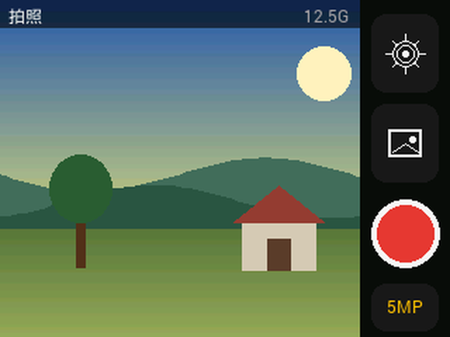
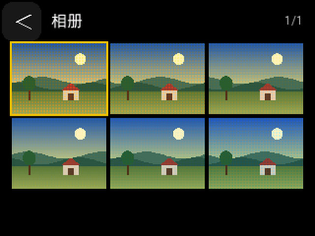
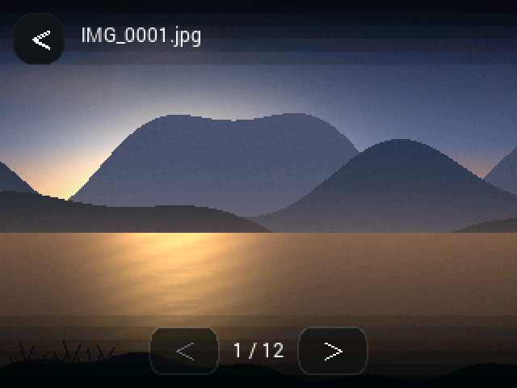
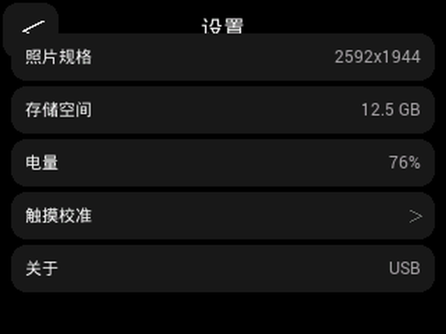
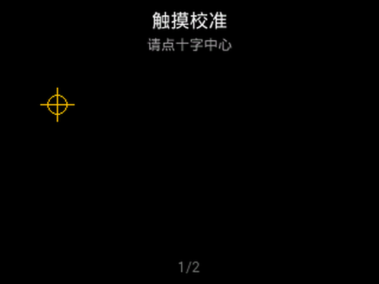

# ZeroSnap

[English](README.md) · **中文**

[](https://github.com/hellohub1212/zerosnap/actions/workflows/build.yml)
[](LICENSE)
[](https://www.raspberrypi.com/products/raspberry-pi-zero/)
[](native/src/ui.c)
[](app/)
[](docs/architecture.md)
[](docs/tuning.md)

一台**开机直接进取景框**的随身相机：树莓派 Zero + 2.4 寸 SPI 屏，
**不启动桌面、不用 X11、不用 SDL、不用 pygame**。界面是 C11 直接写
`/dev/fb1`，相机由一个小 Python 守护进程负责，两者通过共享内存通信。



| 相册 | 照片 |
|:---:|:---:|
|  |  |

| 设置 | 触摸校准 |
|:---:|:---:|
|  |  |

*截图由真实的 320×240 界面渲染；示例照片是合成风景，不是第三方图片。*

## 目录

- [为什么会有这个项目](#为什么会有这个项目)
- [功能](#功能)
- [硬件](#硬件)
- [安装](#安装)
- [触摸校准](#触摸校准)
- [工作原理](#工作原理)
- [性能](#性能)
- [目录结构](#目录结构)
- [测试](#测试)
- [限制](#限制)
- [参与贡献](#参与贡献)
- [许可](#许可)
- [致谢](#致谢)

## 为什么会有这个项目

第一版是 Python + pygame + X11。功能都能跑，但屏幕只有 **0.9 fps**：

```
preview: 25.5 fps, capture=39 ms, convert=0.2 ms   ← 相机完全正常
ui: 0.9 fps, update+draw+flip=1004 ms/frame        ← 显示链路不正常
```

320×240 的一帧在 ARMv6 上只要几毫秒。那一秒全花在阻塞的显示调用里：
X11 → 传统 framebuffer → `fbcp` → `vc_dispmanx_snapshot()` → SPI 屏。
把整条链路删掉、直接往面板的 framebuffer 写 16 位像素之后，同一块板子跑到了
**26.5 fps** —— 这已经是 SPI 的上限（153,600 字节/帧，31.25 MHz 下 39 ms）。

所以这不是"把 Python 用 C 重写一遍来提速"，而是一台**根本不使用显示服务器**
的相机。

## 功能

- **开机约 8 秒**先进入两点校准，再进取景框，没有登录、没有桌面；
- **26 fps**（320×240 SPI 屏，瓶颈在面板不在 CPU）；
- **500 万像素拍照**（2592×1944，OV5647）；
- **机内相册**：守护进程给每张照片预生成 320×240 RGB565 预览，
  界面不需要解码 JPEG，翻页是即时的；
- **照片存在 FAT32 启动分区**（`/boot/firmware/Camera`），
  插到 Windows / macOS 上直接就能拷走；
- **每次开机都校准触摸**：屏幕被旋转了 270°，而 ADS7846 上报的是面板原始轴，
  开机先点两下自动算出轴变换，再进取景框；保存的配置只在向导超时时兜底；
- **不怕崩**：守护进程有监督循环，界面每秒重连共享内存；连续失败 3 次后
  把 console 留在屏幕上并写日志，而不是黑屏；
- **不联网、不上云、没有遥测。**

## 硬件

| 部件 | 说明 |
|---|---|
| 树莓派 Zero v1.3 | ARMv6，512 MB。Zero W 同理，Zero 2 W 更快。 |
| 2.4 寸 ILI9341 SPI 屏，320×240 | 常见的 "tft9341" 模块，带 ADS7846 电阻触摸。 |
| OV5647 摄像头 | 其他 libcamera 支持的传感器应该也能用。 |
| microSD，8 GB 以上 | 照片放在启动分区。 |

安装脚本自带 `tft9341` 设备树 overlay（来自 LCD-show），并向 `config.txt`
写入 `speed=32000000,fps=60,txbuflen=65536`。

## 安装

在全新的 **Raspberry Pi OS Bookworm（32 位 Lite）** 上：

```bash
sudo apt update
sudo apt install -y build-essential python3-picamera2 python3-numpy python3-pil

git clone https://github.com/hellohub1212/zerosnap.git
cd zerosnap
sudo bash install/install.sh
sudo reboot
```

安装脚本会：

1. 编译 `zerosnap-ui`，把整套东西装到 `/opt/zerosnap`；
2. 安装 `zerosnap-ui.service` 并占用 tty1，停用 LightDM / fbcp；
3. 写入屏幕 overlay 和刷新参数；
4. 预编译 `libyuv420.so`，保证开机不需要调用编译器；
5. 创建 `/boot/firmware/Camera` 和 `.preview` 缓存目录；
6. 把 Xorg 指到 `/dev/fb1`，并把 LightDM 的自动登录会话设成 LXDE。

回到桌面：**设置 → 退出到桌面**。相机会先正常停止，然后 LightDM 启动
LXDE；桌面上的 **ZeroSnap 相机** 图标可以一键切回相机。命令行等价于：

```bash
sudo systemctl start zerosnap-desktop   # 相机 -> 桌面
sudo systemctl start zerosnap-ui        # 桌面 -> 相机
```

### 在电脑上交叉编译

把 SD 卡挂到电脑，装了 `clang` + `lld` 就不需要任何模拟器：

```bash
sudo bash native/build-arm.sh --root /mnt/card
sudo bash install/install.sh --root /mnt/card --boot /mnt/cardboot
```

## 触摸校准

屏幕在 overlay 里被旋转了 270°，但 ADS7846 上报的是面板原始坐标。
如果不做轴变换，所有点击都会偏 90° —— 表现就是"按钮按了没反应"。

每次开机会先出现两点校准：依次点两个十字，程序从 8 种轴变换里选出正确的
那个，结果写到 `/boot/firmware/zerosnap-touch.conf`（FAT32，Windows 可直接改）：

```
swap=1
invert_x=0
invert_y=1
```

如果 45 秒内没有任何触摸事件，向导会自动退出并沿用保存的变换，不会把设备
卡在校准页。之后可以在 **设置 → 触摸校准** 随时重新校准。

## 工作原理

```
┌──────────────────────────────┐          ┌──────────────────────────────┐
│ zerosnap-ui           (C11)  │          │ app.daemon          (Python) │
│                              │          │                              │
│  /dev/fb1   直接 mmap        │   共享   │  Picamera2 / libcamera       │
│  /dev/input evdev 触摸       │◀────────▶│  拍照 → JPEG                 │
│  命中测试、视图、图标        │   内存   │  320×240 RGB565 预览         │
│  预渲染文字图集              │          │  .565 相册缩略图             │
└──────────────────────────────┘          └──────────────────────────────┘
```

- **一个共享内存段**（`/dev/shm/zerosnap-shm`）承载双缓冲的 320×240 RGB565
  帧、状态快照和命令序号。没有 JSON、没有解析、热路径上没有内存分配。
- **文字在构建期就渲染好了。** `tools/gen_font.py` 把每条界面文案（外加一套
  ASCII 字模，供文件名、数字使用）栅格化成 8 位 alpha 位图。运行时不需要
  freetype，也不需要字体文件。
- **预览是预转换的。** 守护进程给每张照片生成 `Camera/.preview/*.565`，
  相册直接 blit。
- **视频是有意删掉的。** Pi Zero 在这套配置下撑不起可用的 H.264 帧率，
  一台 20 秒只能录 9 帧的相机不如只拍照。

更多细节见 [`docs/architecture.md`](docs/architecture.md)。

## 性能

实测：Pi Zero v1.3，320×240，SPI 请求 32 MHz（实际 31.25 MHz）：

| 指标 | 数值 |
|---|---|
| 界面帧率 | **26.5 fps** |
| 绘制 | 3.4 ms |
| 提交（`memcpy` 进 `/dev/fb1`） | 18 ms |
| 相机预览 | 25 fps（传感器模式上限） |
| 整帧 SPI 传输 | 39 ms（理论上限 25.4 fps） |

启动速度也做过专项优化：固件阶段从 15–29 秒（会因 FAT 修复而波动）降到约
10 秒，取景器服务从 27–41 秒提前到约 12 秒。Python 导入与媒体分区挂载并行，
PyAV 改为按需加载，LightDM 也不再为 SPI 屏根本不存在的 DRM 设备等 90 秒。
细节和日志时间点见 [`docs/tuning.md`](docs/tuning.md)。

瓶颈在面板。可以直接用 `zerosnap-bench` 测：

```bash
sudo systemctl stop zerosnap-ui
/opt/zerosnap/bin/zerosnap-bench --seconds 6
sudo systemctl start zerosnap-ui
```

可调参数和取舍见 [`docs/tuning.md`](docs/tuning.md)。

## 目录结构

```
app/                 Python 相机守护进程
  daemon.py            共享内存发布 + 命令处理
  camera_shm.py        共享内存协议的 Python 半边
  backend/             Picamera2 服务（以及给电脑用的 mock）
  media/storage.py     序号命名
native/              C11 界面，零第三方依赖
  src/fb.c             /dev/fb1 打开 / mmap / 提交
  src/gfx.c            RGB565 绘图原语
  src/text.c           预渲染字形 blit
  src/input.c          evdev（多点 B / 单点 / 压力）
  src/touchcal.c       两点轴校准
  src/ipc.c            共享内存
  src/media.c          媒体扫描 + .565 缓存
  src/ui.c             视图、命中测试、绘制
  src/main.c           主循环
  src/text_data.c      生成的字体图集
  tools/gen_font.py    构建期字体图集生成器
  tools/make_screenshots.py  从真实界面生成 README 截图
install/             安装脚本、systemd 单元、启动脚本、屏幕 overlay
docs/                架构、调优、截图
```

## 测试

全部在开发机上跑，不需要树莓派：

```bash
make test
```

覆盖：字形渲染与裁剪、evdev 解析（多点 B、单点、纯压力、轴变换）、
共享内存的帧/状态/命令协议（C 与 Python 两端）、媒体扫描与缓存失效、
校准求解（8 种变换全测）、以及一个端到端测试——把一帧写进共享内存，
再读回 framebuffer 断言像素。

`make screenshots` 会从真实界面重新生成上面的截图
（`native/tools/make_screenshots.py`，需要 Pillow）。画面由脚本合成，
仓库里不包含任何第三方照片。

## 限制

- **没有视频。** 有意移除，原因见上。
- **最高 500 万像素**（2592×1944）。OV5647 就是 5 MP 传感器，4K 不可能。
- 拍照时预览会短暂冻结，避免编码器和界面争抢相机请求。
- 只在 Raspberry Pi OS Bookworm 32 位上验证过。

## 参与贡献

欢迎提 issue 和 pull request。提交 PR 前请先跑一遍 `make test`，
具体约定见 [`CONTRIBUTING.md`](CONTRIBUTING.md)。

## 许可

MIT，见 [`LICENSE`](LICENSE)。第三方组件及其许可证列在
[`NOTICE.md`](NOTICE.md)。

## 致谢

- [Picamera2](https://github.com/raspberrypi/picamera2) 与 libcamera；
- [LCD-show](https://github.com/goodtft/LCD-show) 提供的 tft9341 overlay；
- 早期 pygame 版本的探索，虽然被替换掉了，但它测出的数据指向了真正的问题。
